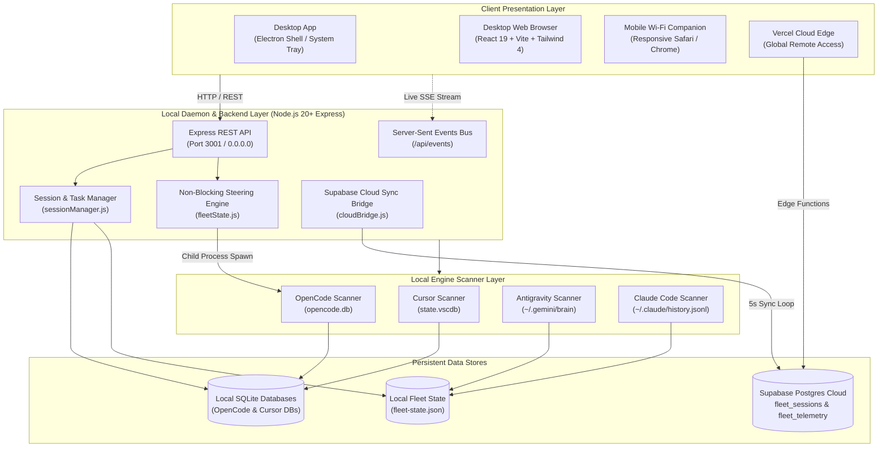
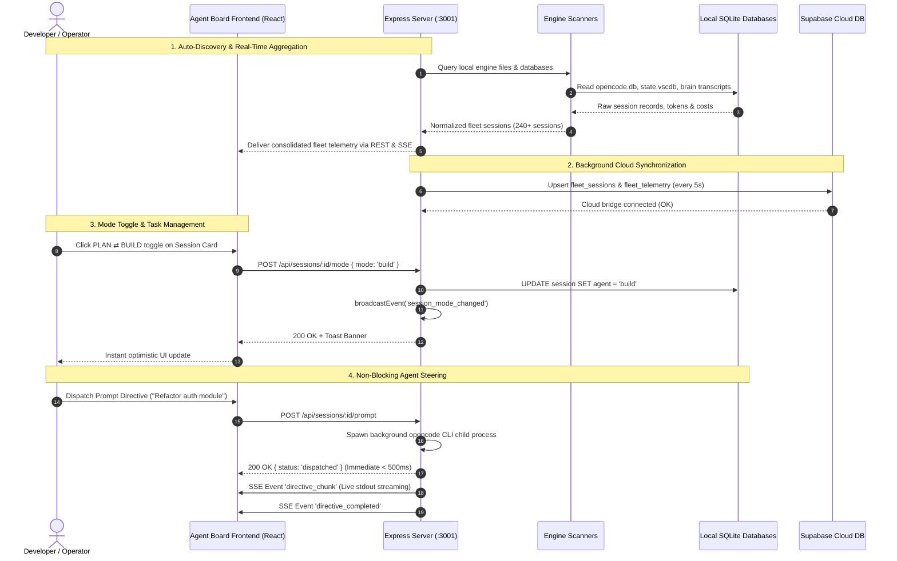
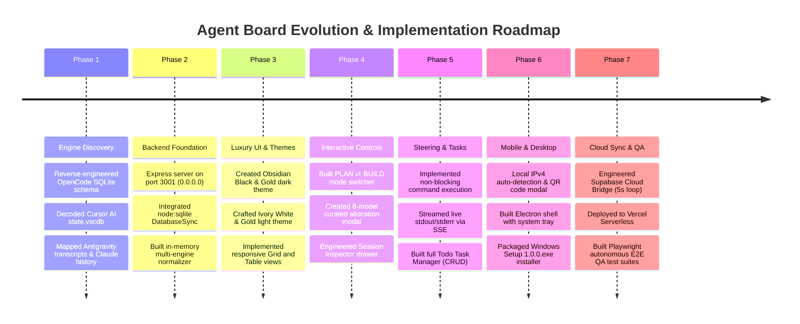

<div align="center">

# ⚡ AGENT BOARD

### Universal Multi-Engine AI Coding Agent Command Center

[](https://nodejs.org)
[](https://react.dev)
[](https://vitejs.dev)
[](https://tailwindcss.com)
[](https://www.electronjs.org)
[](https://sqlite.org)
[](https://supabase.com)
[](https://playwright.dev)

<p align="center">
  <b>A luxury, high-performance orchestration console and desktop app that auto-discovers, monitors, inspects, and steers AI coding agents across OpenCode, Cursor AI, Google Antigravity, and Anthropic Claude Code in real time.</b>
</p>

[Key Features](#-key-features) • [System Architecture](#-system-architecture) • [Tools & Tech Stack](#-tools--tech-stack) • [How It Was Built](#-step-by-step-process-on-how-it-was-built) • [Installation & Setup](#-installation--getting-started) • [API Reference](#-api-endpoints-reference) • [Automated QA Verification](#-autonomous-qa--e2e-testing-suites)

---

</div>

## 📖 Project Overview

Modern AI-augmented software development has fragmented across specialized autonomous agents. Developers run:
- **OpenCode** for background terminal coding and repository tasks;
- **Cursor AI** for real-time composer edits and inline code completions;
- **Google Antigravity (AGY)** for deep agentic planning and pair-programming;
- **Anthropic Claude Code** for command-line terminal reasoning.

Until now, there was no centralized pane of glass to observe total token spend, track cumulative costs across providers, prevent runaway token burn, switch agent operational modes, or dispatch commands remotely from a smartphone.

**Agent Board** solves this by unifying local agent discovery, SQLite state inspection, luxury dual-theme visualization, background steering execution, and cloud synchronization into a single, cohesive ecosystem available as:
1. **A Standalone Windows Desktop App** (`.exe` with background tray daemon)
2. **A High-Speed Local Web Console** (`http://localhost:3001`)
3. **A Mobile Companion** with automatic local Wi-Fi QR code access (`http://192.168.x.x:3001`)
4. **A 24/7 Global Cloud Dashboard** deployed on Vercel Edge with Supabase synchronization

---

## ✨ Key Features

### 🔍 1. Zero-Config Multi-Engine Auto-Discovery
Automatically scans and monitors local storage and databases across your machine:
- **OpenCode**: Reads `opencode.db` via high-speed SQLite sync (`node:sqlite`).
- **Cursor AI**: Reads `%APPDATA%\Cursor\User\globalStorage\state.vscdb` workspaces.
- **Antigravity**: Discovers brain transcripts and identifies the actively running session.
- **Claude Code**: Tail-reads `~/.claude/history.jsonl` session streams.

### 🎨 2. Luxury Obsidian Black, Ivory White & Gold Aesthetic
- **Obsidian Dark Mode**: Deep void backgrounds (`#07090E`), onyx glass panels, metallic gold borders (`#D4AF37`), subtle golden ambient glows, and high-contrast typography.
- **Ivory Light Mode**: Crisp alabaster background (`#FDFBF7`), soft ivory elevated cards, metallic gold trims, and dark charcoal slate typography.
- **Instant Theme Switcher**: 1-click header toggle persisted in `localStorage`.

### 📊 3. Real-Time Telemetry & Fleet KPIs
- **Active Fleet**: Live pulsing emerald beacon indicating currently executing sessions within a 20-minute heartbeat window.
- **Connected Tools**: Real-time counter of installed and discovered local engines.
- **Total Fleet Cost**: Aggregated cost in USD across DeepSeek, Anthropic Claude, OpenAI, and Google Gemini models.
- **Token Burn Counter**: Total input, output, reasoning, and cache tokens formatted in standard SI units (`51.6M`, `61.7M`).

### 🕹️ 4. Dynamic PLAN ⇄ BUILD Mode Switching
- Switch any session's operational posture on the fly.
- **`PLAN` Mode**: Restricts agent to architecture, read-only analysis, and review-ready planning.
- **`BUILD` Mode**: Empowers agent to write files, run terminal commands, and implement features.
- Mode updates persist directly to SQLite and trigger real-time SSE broadcasts.

### 🧠 5. Curated Multi-Provider Model Allocation
Reallocate LLM models per session on the fly from an integrated catalog:
- `DeepSeek v4.1 Flash` & `DeepSeek v4 Pro` (Fast & Heavy Reasoning)
- `Claude 3.5 Sonnet` & `Claude 3.7 Sonnet` (Top Agentic Coding)
- `GLM-5.3 Flash` & `Kimi k3` (Long Context)
- `Google Gemini 3.8 Flash` & `OpenAI GPT-4o`

### 📋 6. Full Task Checklist (CRUD) & Session Inspector
- Click any session card to open a slide-over drawer displaying high-resolution metadata.
- **Todo Manager**: Add milestone tasks with priority tags (`urgent`, `high`, `medium`, `low`), toggle task completion, and delete tasks.
- **Conversation Thread**: Inspect user prompts, agent reasoning thoughts, tool calls, and execution diffs.

### 🚀 7. Non-Blocking Agent Steering Directives
- Type manual instructions directly into any agent session from the web or mobile.
- Executes asynchronously without freezing the UI or blocking Node's event loop.
- Live stdout/stderr chunks stream in real time via Server-Sent Events (SSE).

### 📱 8. Local Wi-Fi Companion & QR Code Remote Control
- Auto-detects your PC's local network IPv4 address (e.g., `http://192.168.1.97:3001`).
- Generates a scannable QR code in the navbar for immediate control from iOS or Android smartphones on your local network.

### ☁️ 9. 24/7 Supabase Cloud Sync Bridge
- Background bridge polls local state every 5 seconds and upserts sessions to Supabase.
- Enables global access on Vercel even when outside your local Wi-Fi.

---

## 🏛️ System Architecture



---

## 🔄 Data & Execution Flow



---

## 🛠️ Tools & Tech Stack

| Layer | Technology | Version | Purpose & Rationale |
|:---|:---|:---|:---|
| **Frontend Framework** | React | `^19.0.0` | High-performance reactive UI with instant optimistic state updates |
| **Build Tool** | Vite | `^6.4.3` | Sub-second HMR and production bundle optimization (259 kB gzipped) |
| **Styling** | Tailwind CSS | `^4.0.0` | Dynamic utility-first design system with native dark/light variables |
| **Icons** | Lucide React | `^0.475.0` | Cohesive, featherweight iconography for tools, metrics, and actions |
| **Desktop Shell** | Electron | `^34.0.0` | Native Windows application wrapper with system tray minimize-to-background |
| **Desktop Packaging** | Electron Builder | `^25.1.8` | Compiles standalone portable `.exe` and NSIS Windows installer packages |
| **Backend Framework** | Express.js | `^4.21.0` | Lightweight HTTP/SSE server binding to `0.0.0.0` for desktop & mobile |
| **Database Engine** | `node:sqlite` | Node 20+ Built-in | Fast, zero-dependency synchronous SQLite driver for OpenCode & Cursor |
| **Real-time Bus** | Server-Sent Events | Standard HTTP | Low-overhead uni-directional server-to-client streaming for logs & metrics |
| **Cloud Database** | Supabase | `@supabase/supabase-js` | PostgreSQL cloud backend hosting sessions for Vercel edge access |
| **Cloud Hosting** | Vercel | Serverless Edge | Global CDN distribution for the web companion |
| **Testing Harness** | Playwright Core | `^1.50.0` | Automated headless browser end-to-end verification via Microsoft Edge |

---

## 🏗️ Step-by-Step Process: How It Was Built



### Phase 1: Local Engine Discovery & Reverse-Engineering
1. Located local SQLite databases for **OpenCode** (`opencode.db`) and **Cursor AI** (`state.vscdb`).
2. Mapped schema tables: `session`, `todo`, `message`, `part`, `project`.
3. Created parser utilities to extract token consumption (`tokens_input`, `tokens_output`, `tokens_reasoning`) and cumulative compute cost.
4. Added scanner for **Google Antigravity** brain sessions located in `~/.gemini/antigravity/brain` and mapped active conversations.

### Phase 2: High-Performance Normalization Backend
1. Developed [`server/scanners/index.js`](file:///c:/Users/KARAN/Desktop/Web%20Development/Anti%20Gravity/AI%20Agent%20Dashboard/server/scanners/index.js) to aggregate 240+ sessions across disparate sources into a standard schema.
2. Built file watchers on the database directories to detect external tool modifications and trigger real-time updates.
3. Created [`server/fleetState.js`](file:///c:/Users/KARAN/Desktop/Web%20Development/Anti%20Gravity/AI%20Agent%20Dashboard/server/fleetState.js) to persist overrides (custom modes, models, archives) without corrupting third-party database tables.

### Phase 3: Luxury UI with React 19 & Tailwind 4
1. Designed a bespoke **Obsidian Black, Metallic Gold, and Alabaster White** design system.
2. Developed the **Active Fleet** live pulse beacon and 4 high-density KPI summary cards.
3. Implemented responsive view switching: **Grid Cards View** for visual inspection and **Compact Table View** for high-density navigation.

### Phase 4: Mode Switcher & Model Allocation
1. Engineered [`ModeSwitchBadge.jsx`](file:///c:/Users/KARAN/Desktop/Web%20Development/Anti%20Gravity/AI%20Agent%20Dashboard/client/src/components/ModeSwitchBadge.jsx) to enable toggling between `PLAN` and `BUILD` modes with instant feedback.
2. Built [`ModelSelectorModal.jsx`](file:///c:/Users/KARAN/Desktop/Web%20Development/Anti%20Gravity/AI%20Agent%20Dashboard/client/src/components/ModelSelectorModal.jsx) populated with curated presets across Anthropic, DeepSeek, Google, and OpenAI.

### Phase 5: Session Inspector & Todo Manager
1. Developed [`SessionInspector.jsx`](file:///c:/Users/KARAN/Desktop/Web%20Development/Anti%20Gravity/AI%20Agent%20Dashboard/client/src/components/SessionInspector.jsx), featuring:
   - Header with quick clipboard session ID copy;
   - Tab 1: Metadata telemetry and interactive Todo task checklist (Add, Complete, Delete);
   - Tab 2: Chronological conversation transcript with collapsible reasoning blocks and tool executions.

### Phase 6: Non-Blocking Agent Steering
1. Re-architected command dispatching from synchronous blocking calls to asynchronous child processes (`spawn`).
2. Configured stdout/stderr pipe streaming through an Express Server-Sent Events (SSE) bus (`/api/events`), enabling immediate API responses (< 500ms) while the agent executes in the background.

### Phase 7: Mobile Access & Desktop Packaging
1. Created `/api/network` to auto-detect the workstation's active LAN IPv4 address.
2. Implemented [`MobileAccessModal.jsx`](file:///c:/Users/KARAN/Desktop/Web%20Development/Anti%20Gravity/AI%20Agent%20Dashboard/client/src/components/MobileAccessModal.jsx) with a dynamic QR code generator.
3. Configured Electron in [`desktop/main.cjs`](file:///c:/Users/KARAN/Desktop/Web%20Development/Anti%20Gravity/AI%20Agent%20Dashboard/desktop/main.cjs) with background daemon capabilities, minimize-to-system-tray behavior, and packaged installer binaries (`dist-desktop/Agent Board Setup 1.0.0.exe`).

### Phase 8: Cloud Bridge & Supabase Integration
1. Implemented [`server/cloudBridge.js`](file:///c:/Users/KARAN/Desktop/Web%20Development/Anti%20Gravity/AI%20Agent%20Dashboard/server/cloudBridge.js) to synchronize local telemetry and active sessions to Supabase tables every 5 seconds.
2. Created Vercel Edge API handlers in [`api/`](file:///c:/Users/KARAN/Desktop/Web%20Development/Anti%20Gravity/AI%20Agent%20Dashboard/api) for cloud-hosted dashboard access.

### Phase 9: Autonomous QA Verification
1. Created autonomous test harnesses: [`server/api-deep-test.js`](file:///c:/Users/KARAN/Desktop/Web%20Development/Anti%20Gravity/AI%20Agent%20Dashboard/server/api-deep-test.js) (53 boundary tests) and [`server/e2e-browser-test.js`](file:///c:/Users/KARAN/Desktop/Web%20Development/Anti%20Gravity/AI%20Agent%20Dashboard/server/e2e-browser-test.js) (36 Playwright UI tests).
2. Resolved mobile and tablet horizontal overflow issues and verified **129/129 checks passing (100%)**.

---

## 🚀 Installation & Getting Started

### Prerequisites
- **Node.js**: `v20.0.0` or higher ([Download Node.js](https://nodejs.org))
- **Operating System**: Windows 10/11, macOS, or Linux
- **AI Tools** (Optional but detected automatically): OpenCode, Cursor AI, Antigravity, or Claude Code

---

### Option A: Native Desktop App (Windows)

1. Navigate to the compiled binaries directory:
   ```bash
   dist-desktop/Agent Board Setup 1.0.0.exe
   ```
2. Double-click the installer to install **Agent Board** onto your machine.
3. The application will launch, dock to your Windows system tray, and automatically manage the internal server in the background.

---

### Option B: Run Locally from Source

1. **Clone the Repository**:
   ```bash
   git clone https://github.com/KaranDarade/Agent-Board.git
   cd Agent-Board
   ```

2. **Install Dependencies**:
   ```bash
   npm install
   npm --prefix client install
   ```

3. **Build the Frontend**:
   ```bash
   npm run build
   ```

4. **Start the Agent Board Server**:
   ```bash
   npm start
   ```

5. Open your browser:
   - **Local Desktop**: [http://localhost:3001](http://localhost:3001)
   - **Mobile (Same Wi-Fi)**: Check the terminal for your LAN IP (e.g., `http://192.168.1.97:3001`)

---

### Option C: Development Mode (Hot-Reloading)

To run the backend server and Vite client concurrently with hot-reloading:

```bash
npm run dev
```
- Frontend dev server: `http://localhost:5173` (proxies `/api` to port 3001)
- Backend daemon: `http://localhost:3001`

---

### Option D: Build Desktop Installer from Source

To package the standalone native desktop application and installer:

```bash
npm run dist
```
Compiled setup executables will be output to `dist-desktop/`:
- `Agent Board Setup 1.0.0.exe` (NSIS installer)
- `Agent Board 1.0.0.exe` (Standalone portable executable)

---

## 🌐 Cloud Deployment (Vercel & Supabase)

Agent Board includes built-in serverless adapters in the `api/` directory configured via `vercel.json`.

### 1. Supabase Setup
1. Create a free project at [supabase.com](https://supabase.com).
2. In the Supabase SQL Editor, run:
   ```sql
   create table if not exists fleet_sessions (
     id text primary key,
     tool_name text,
     title text,
     directory text,
     project_name text,
     model text,
     role text,
     status text,
     is_active boolean default false,
     cost numeric default 0,
     tokens numeric default 0,
     tasks_count integer default 0,
     completed_tasks_count integer default 0,
     updated_at timestamp with time zone default timezone('utc'::text, now())
   );

   create table if not exists fleet_telemetry (
     id text primary key,
     stats jsonb,
     updated_at timestamp with time zone default timezone('utc'::text, now())
   );
   ```

### 2. Environment Variables
Add the following to your `.env` or Vercel Project Settings:
```env
SUPABASE_URL=https://<your-project-id>.supabase.co
SUPABASE_SERVICE_ROLE_KEY=<your-service-role-key>
```

### 3. Vercel Deployment Protection Notice
> [!IMPORTANT]
> If your deployed Vercel site redirects to a **"Log in to Vercel"** page, your Vercel project has **Deployment Protection (Vercel Authentication)** enabled.
> 
> To make the dashboard publicly accessible:
> 1. Open your **Vercel Dashboard** $\rightarrow$ Select **Agent-Board** project.
> 2. Go to **Settings** $\rightarrow$ **Deployment Protection**.
> 3. Under **Vercel Authentication**, set the toggle to **Disabled**.
> 4. Click **Save**. The dashboard and APIs will immediately serve without login requirements.

---

## 📡 API Endpoints Reference

| Method | Endpoint | Description | Sample Response |
|:---|:---|:---|:---|
| `GET` | `/api/health` | Service uptime and heartbeat | `{"status":"ok","uptime":3600}` |
| `GET` | `/api/network` | Workstation local IP and mobile companion URL | `{"localIp":"192.168.1.97","port":3001}` |
| `GET` | `/api/fleet/stats` | Consolidated multi-engine telemetry & token stats | `{"totalSessions":243,"totalCost":28.98,...}` |
| `GET` | `/api/fleet/sessions` | Multi-engine sessions with filters (`?tool=`, `?search=`) | `[{"id":"ses_...","tool":"opencode",...}]` |
| `GET` | `/api/sessions/:id` | High-resolution session detail and directive history | `{"id":"ses_...","directives":[],...}` |
| `POST` | `/api/sessions/create` | Create review-ready session (`Option B` safety model) | `{"id":"ses_...","role":"plan",...}` |
| `POST` | `/api/sessions/:id/mode` | Switch operational mode (`plan` ⇄ `build`) | `{"success":true,"role":"build"}` |
| `POST` | `/api/sessions/:id/model` | Reallocate session model preset | `{"success":true,"model":"claude-3-7-sonnet"}` |
| `POST` | `/api/sessions/:id/tasks` | Add task checklist item to session | `{"id":0,"content":"Verify auth","status":"pending"}` |
| `PATCH`| `/api/sessions/:id/tasks/:taskIdentifier` | Update task status or priority | `{"position":0,"status":"completed"}` |
| `DELETE`| `/api/sessions/:id/tasks/:taskIdentifier` | Remove task checklist item | `{"success":true}` |
| `POST` | `/api/sessions/:id/prompt` | Dispatch non-blocking steering directive to agent | `{"success":true,"status":"dispatched"}` |
| `POST` | `/api/sessions/:id/deactivate` | Archive session to prevent background token burn | `{"success":true,"status":"archived"}` |
| `POST` | `/api/sessions/:id/activate` | Reactivate archived session | `{"success":true,"status":"active"}` |
| `GET` | `/api/events` | Real-time SSE stream for live updates & logs | `event: fleet_updated\ndata: {...}` |

---

## 🧪 Autonomous QA & E2E Testing Suites

Agent Board includes 3 comprehensive automated test suites covering backend routes, database integrity, edge cases, and headless browser interactions.

```bash
# 1. Run Baseline Regression Test Suite (40 checks)
node server/test-suite.js

# 2. Run Comprehensive API & Boundary Test Suite (53 checks)
node server/api-deep-test.js

# 3. Run Playwright E2E Headless Browser UI Test Suite (36 checks)
node server/e2e-browser-test.js
```

### Verification Results Summary

```text
======================================================
  AGENT BOARD E2E AUTONOMOUS VERIFICATION PASS
======================================================
  ✔ Baseline Regression Suite:      40 / 40 PASSED (100%)
  ✔ Deep API & Boundary Suite:       53 / 53 PASSED (100%)
  ✔ Playwright Headless Edge E2E:    36 / 36 PASSED (100%)
------------------------------------------------------
  TOTAL VERIFICATION CHECKS:        129 / 129 PASSED (100%)
======================================================
```

---

## 🔒 Security & Privacy

- **Local-First Architecture**: Your code, database files, and private workspace transcripts stay entirely on your local machine.
- **Zero Third-Party Database Modification**: Mode changes and overrides are persisted safely in [`server/fleet-state.json`](file:///c:/Users/KARAN/Desktop/Web%20Development/Anti%20Gravity/AI%20Agent%20Dashboard/server/fleet-state.json) without altering proprietary SQLite tables.
- **Electron Security**: Window instances enforce `contextIsolation: true`, `nodeIntegration: false`, and `webSecurity: true`.
- **Injection Protection**: All SQLite queries use parameterized prepared statements to eliminate SQL injection vulnerabilities.

---

## 📄 License

This project is licensed under the [MIT License](LICENSE).

---

<div align="center">
  <sub>Engineered with precision for autonomous AI coding agent workflows. Built by <b>Karan Darade</b>.</sub>
</div>
